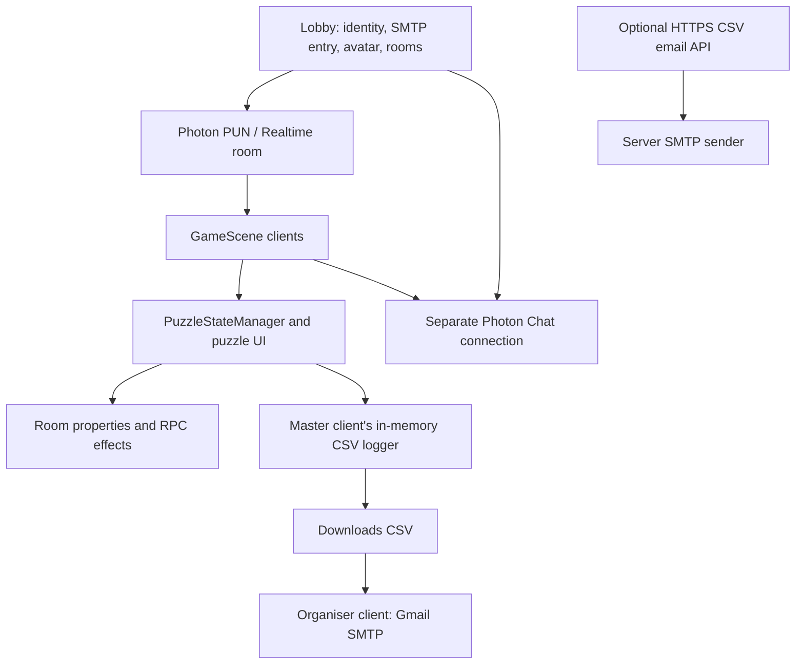
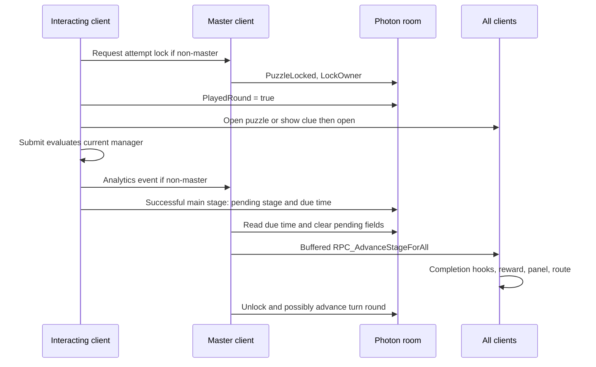

# SGH Architecture

## Evidence and system boundary

Implementation snapshot: 8 September 2026. Read with [PRD.md](PRD.md), which contains player flow, scene puzzle thresholds, answers, rewards, and acceptance scenarios. This document describes source and serialized configuration; runtime recovery and rendering still require Unity/two-client verification.

Unity editor is `6000.3.11f1`; package manifest pins URP `17.3.0`, Input System `1.19.0`, and Unity Test Framework `1.6.0`. Player scripts currently use legacy `Input` axes/buttons. Enabled build scenes are Lobby and GameScene. SampleScene is disabled; `_Recovery` scenes are not the build flow.

There is no Unity-to-HTTP-API edge in the current code. Photon Cloud transports gameplay state; a replaceable player client acts as master. The .NET service handles email only, not rooms, chat, timers, puzzle validation, or analytics storage.

## Source map

| Area | Responsibilities |
| --- | --- |
| `Assets/Scripts/networking` | Home form, Photon identity/connect/rejoin, room creation/list/join/start, Chat, in-memory SMTP details. |
| `CharacterSelection.cs`, `GameManager.cs` | Avatar property, Photon spawning, inactive-avatar cleanup, gameplay rejoin, leave/restart/quit. |
| `Assets/Scripts/Player` | Owned movement/camera, crosshair, tags, inventory, clue collection, route pointer and waypoint triggers. |
| `Assets/Scripts/Interactable`, `Keypad` | Puzzle entry, pickups, highlighting, door hinge/unlock, world keypad buttons, synchronized moving object. |
| `Assets/Scripts/Puzzle` | Stage/turn authority, validators, card and control synchronization, optional score summary, CSV logger and unused HTTP settings asset type. |
| `Assets/Scripts/UI` | Shared clue/comic controls, queued notifications, sidebar, inventory rendering, loading UI, date labels. |
| `StorylineDirector.cs`, `TriggerComic.cs`, `QueueNumberDisplay.cs` | Stage-driven scene effects, local comic triggers, queue/status display and flashing. |
| `core/DateFormatAttribute.cs` | Inspector date-format selector and preview, with editor-only drawer guarded by `UNITY_EDITOR`. |
| `Assets/Scenes`, `Assets/Prefabs`, `Assets/Resources` | Scene references, answer configuration, UI events, Photon-instantiated Doctor/Nurse/Therapist prefabs. |
| `backend/SghCsvEmailApi` | Independent ASP.NET Core .NET 10 multipart CSV-to-email service. |

Filename/type mismatches matter when searching: `GameTimeManager.cs` defines `GameTimerManager`; `PuzzlePanelTrigger.cs` defines `PuzzleTrigger`; `SlideShowUI.cs` defines `SlideshowUI`; `SideBarMenuManager.cs` defines `SidebarMenuManager`; `CrossHairInteractor.cs` defines `CrosshairInteractor`; `PhotonSyncedInputField.cs` defines `PhotonSyncedTMPInputField`; `MovementTargetNetworked.cs` defines `MovementTargetForward`.

Photon, TextMesh Pro examples, LeanTween, and Unity packages are vendor dependencies. Rotation puzzle scripts are local auxiliary code, not a twelfth registered puzzle. Tutorial Readme/editor code supports Unity's project introduction.

## Lobby, identity, and avatar lifecycle

`Network.Start` establishes a GUID user ID in PlayerPrefs (`PhotonUserId`), assigns it to Photon authentication, enables automatic scene sync, connects, and ensures a ChatManager exists. It clears the old saved nickname and runtime SMTP details. The home form advances through username, sender email, app password, and recipient; only after completion does it set NickName/PlayerTag and show room-list controls.

`SessionSmtpCredentials` validates addresses using MailAddress, trims input, removes spaces from the app password, and keeps strings in static memory. Only `SessionOrganizerActorNumber` is shared with the room; credentials are not Photon properties. The room creator writes that actor number on joining. It is not automatically replaced when Photon elects another master.

`CreateRoomManager` caches discoverable rooms, checks names, creates a random six-character password from an ambiguity-reduced alphabet, and builds RoomOptions with capacity, PlayerTtl 600000 ms, EmptyRoomTtl 300000 ms, and PublishUserId. `RoomPassword` is exposed to the lobby. Failed creates retry after two seconds. This is client-managed room UX, not server access authorization.

`JoinRoomManager` maintains a cached room list and instantiates entries under `contentPanel`; the selected room's password is checked locally. It populates waiting-room players and gates Start to the master. Start sets IsVisible false, IsOpen true, broadcasts loading UI, and calls `PhotonNetwork.LoadLevel("GameScene")`. `LoadingScreenManager` displays a random tip and Photon loading progress; its fade loops calculate alpha but do not apply it to a graphic.

Its legacy OnJoinRandomFailed fallback creates an unnamed room with only MaxPlayers configured, then assigns the organiser after joining. It does not use CreateRoomManager's password/TTL options; those settings should not be assumed for every possible room-creation path.

`CharacterSelection.SetCharacter` writes `CharacterIndex` and colors selection buttons. GameScene prefab order is Doctor, Nurse, Therapist. `GameManager` waits 0.5 seconds, checks for an existing owned PlayerController, selects a spawn by sorted ActorNumber, and uses PhotonNetwork.Instantiate. Missing/invalid index becomes 0. Four spawn transforms are assigned; overflow uses spawn 0. No role-specific mechanics or role reservation is implemented.

`PlayerController` creates a PlayerTagDisplay if needed, enables its owned camera, disables the owned PhotonTransformView component, and disables remote camera roots. Movement is camera-relative on the horizontal plane using CharacterController.SimpleMove; mouse pitch clamps to ±85 degrees; walking updates `isWalking`. Q toggles free cursor before the ownership guard in Update. This and multiple independent cursor writers are reasons to test UI/movement together rather than infer it from panel activation.

`PlayerTagDisplay` derives name from PlayerTag, NickName, then actor fallback, positions text above renderer bounds, faces an active camera, and normally hides the owned player's tag.

## Gameplay state and authority

`PuzzleStateManager` is the integration point for eleven `IPuzzle` handlers and stage panels. `IPuzzle` contains only `bool IsSolved()`; reset is explicitly dispatched by the state manager, not defined by the interface. The singleton calls DontDestroyOnLoad on its GameObject. GameScene places it alongside multiple other managers, so persistence applies to that object and must be considered during scene cleanup.

| State | Writer / transport | Reader and recovery |
| --- | --- | --- |
| `CharacterIndex`, `PlayerTag` player properties | Local player | Spawn choice and tags. |
| `RoomPassword` room property | Creator; exposed to lobby | Join UI compares locally. |
| `SessionOrganizerActorNumber` | Creator | SMTP eligibility; independent of current master. |
| `PuzzleLocked`, `LockOwner` | Master; non-master asks by RPC | Entry and submit visibility; membership repair. |
| `Round` room integer | Master | Clients reset their `PlayedRound` boolean when it changes. |
| `PlayedRound` player boolean | Each client | Master checks all active players to advance turn round. It is not an integer round number. |
| `PendingAdvanceStage`, `PendingAdvanceAt` | Successful submitter writes room properties | Master polls due time and executes main-stage completion; initializes/repairs on master switch. |
| `CurrentStage` | Local field updated by buffered stage/advance RPCs | No dedicated room property storing a complete current-stage snapshot. |
| Timer end time | StartTimer broadcasts buffered SyncTimer(float) | Clients subtract PhotonNetwork.Time; not stored in room properties. |
| `Score_Puzzle{stageInt+1}` | Master, optionally via request RPC | Optional wrong-count summary. Stored label is offset by one from runtime stage. |

Master authority is the coordination design, not a fully enforced server-validation boundary. `Submit()` evaluates locally, scheduling is written by the successful client, and managed-button visibility is not an authorization check on every method. Some all-client completion hooks emit additional shared RPCs themselves. Do not describe all global effects as executed only once by a server.

### Attempt and main-stage transition

`TryBeginAttempt` allows the lock owner to re-enter, and permits cached re-entry access to the same shared attempt. New entry while another player holds the lock is denied. The local attempt flag is set optimistically while a non-master lock request is in flight; there is no atomic grant/acknowledgment protocol around panel opening.

`PuzzleTrigger` either opens directly or requests the master to show a configured clue. All clients receive the open/show message; the clue close callback opens the current-stage panel. Its `clueAlreadyViewed` is local, set on the handling master, and not a durable room property. OpenCurrentStagePanel records submit owner and re-entry access. Managed Submit buttons are found by name; PictureGridManager handles its own submit object and selection count.

Wrong answers remain in the same stage/part, record analytics, and generally mark optional score counts; they do not release the lock. After success, DelayAndAdvance immediately schedules room properties rather than waiting locally. The master reads them in Update, clears pending fields, then sends AllBuffered completion. This is recoverable scheduling, but clearing then broadcasting is not an atomic transaction or exactly-once terminal latch.

The scene delay is two seconds. Multipart changes for Puzzle 4, Diary, and Death Lapses use unbuffered all-client RPCs. Insulin part 1 waits in a local two-second coroutine before broadcasting part 2. Those pages/local flags are not covered by PendingAdvanceStage/At and can be lost during interruption/rejoin.

### Stage integrations

| Runtime stage | Handler and folder | Special completion/reset integration |
| --- | --- | --- |
| 1 | SymptomsCardManager, activity 1 | All registered slots checked; completion opens 2; reset Activity1 cards/fronts. |
| 2 | BearCardManager, activity 2 | Threshold validator; Crystal1; reset Activity1_2 cards. |
| 3 | PictureGridManager, activity 3 | Exact selected set; completion opens 4; reset shared buttons. |
| 4 | Activity2PuzzleManager, activity 4 | Step placement then two text answers; reset cards and part-2 text/panel state; Crystal2. |
| 5 | WordSearchManager, activity 9 | Complete target paths with no extras; reset rebuilds grid and clears persisted selection/results. |
| 6 | DiaryPuzzleManager, activity 6 | Three configured answer pages; reset all text and stage 1; Crystal3. |
| 7 | RiskTable, activity 10 | Dropdown index comparison; reset values/feedback; opens 8. |
| 8 | PrescriptionManager, activity 7 | Trimmed string answer; reset input; Crystal4. |
| 9 | CrosswordManager, activity 5 | Fixed solution; reset text/results and rebuild cells; switch hint objects. |
| 10 | InsulinPuzzleManager, activity 8 | Dedicated syringe submit then nine step matches; reset cards/dropdown/part visibility. |
| 11 | DeathLapsesManager, activity 11 | Stage1Slot/Stage2Slot linked-answer matching; reset cards/unlock flags/second-stage visibility; Crystal5, world movement, CSV. |

PRD.md records exact current thresholds and answers. `DropSlot.allDropSlots` registers on Start and unregisters on destruction, not disable; several validators iterate this global collection. Some reset searches only find active cards. Therefore activation order, tags, card behavior, and panel lifetime affect validation/reset; do not assume every loop is scoped to the currently visible puzzle.

Reward configuration: stage 2→clue 325, 4→154, 5→477, 7→28, 9→135. Crystal rewards occur after 2, 4, 6, 8, 11. Trigger hiding honors `dontDestroyOnCompletion` and Photon view references. `puzzle4Object` is unassigned in GameScene. Stage 11 does not increment CurrentStage, stop the timer, or call ShowEndScreen.

## Shared inputs, drag ownership, and event contracts

| Component | Synchronization and persistence |
| --- | --- |
| DraggableCard | IPunObservable streams dragging/name, parent path, anchored position, and scale. Room keys `CardParentPath_`, `CardAnchoredPos_`, `CardScale_`, `CardColor_` append ViewID. Owner persists layout; feedback can be persisted separately. |
| PhotonSyncedTMPInputField | Text to Others by RPC with per-actor sequence rejection; `TMPInputText_<ViewID>` and `TMPInputColor_<ViewID>` restore on enable. Suppression avoids feedback loops. |
| PhotonSyncedTMPDropdown | Value/feedback RPCs to Others; `TMPDropdownValue_` and `TMPDropdownColor_` by ViewID; restores on enable. |
| PhotonSyncedUIButtonColor | Selection/result are distinct; AllViaServer RPCs order toggles and results. `UIButtonSelected_` and `UIButtonResultState_` by ViewID persist state; StateChanged refreshes picture selection/count. Group metadata does not enforce single selection. |
| CrosswordManager | `P5CW_<x>_<y>` text; `P9CW_RESULT_<x>_<y>` feedback; events for live changes and room-state replay on enable/build. Coordinates in the solution and visual grid differ. |
| WordSearchManager | `P5WS_<x>_<y>` packs result enum and selected bit; reliable events plus property callbacks. Target letters are fixed; filler is generated deterministically from room name (scene name offline) and grid size, giving clients matching boards. |
| PuzzleFeedbackSyncExtensions | Routes feedback through sync components when present, otherwise falls back to local graphic color. |

A non-owner card drag starts an immediate local preview and requests ownership. Owner/master handles transfer. Incoming owner position does not overwrite an active local drag. If released over a slot while transfer is pending, the card stores that target and finalizes after the EventSystem drop pass and transfer. Occupancy is rechecked; failed transfer reverts the preview. Other clients see the dragging actor tag. Ownership controls card layout, independently of the puzzle submission lock. Right-click opens CardPopupManager locally; front/back helpers are not another puzzle stage.

Hierarchy paths are used for parent restoration, including same-name sibling disambiguation. Preserve path roots, relevant names, PhotonView IDs, tags, and prefab references when editing assets. Crossword/word-search cell managers are responsible for dynamically generated grid state; do not assume a generated cell PhotonView alone supplies stable synchronization.

### Existing event allocation conflict

| Code | Current producers | Current payload shape |
| --- | --- | --- |
| 41 | GameSessionCsvLogger; CrosswordManager text | Analytics: 8 fields (event kind, room, actor, name, puzzle, result, elapsed, snapshot); crossword: 5 fields (x, y, text, actor, sequence). |
| 42 | ClueUI; WordSearchManager | Clue: close-key string, round, remaining; word search: x, y, encoded state. |
| 43 | CrosswordManager result | x, y, result enum. |

These are collisions, not intentionally safe multiplexing. Some handlers check only code and minimum length before casting. Keep a central allocation inventory and migrate all producers/consumers together when fixing them; do not assign new traffic to 41–43. This documentation records the problem without changing runtime behavior.

## Timer and recovery

`GameTimerManager` is in GameTimeManager.cs on GameManager. GameScene overrides the code's 60-second default with 900 seconds. Master-started SyncTimer carries an absolute float Photon timestamp via AllBuffered. Every client computes remaining time in Update; only the master emits threshold warnings. Scene thresholds are 300 and 120 seconds, each with a ten-second slide animation. ResetTimer also broadcasts HideTimeWarning.

Every client calls OnTimerExpired when its copy reaches zero. The state manager performs stage-specific local reset work; the master restarts the shared timer. Stage 0 does nothing. Completion 1→2 and 3→4 does not reset; other numbered completion hooks do, including 11. Clues set Time.timeScale to zero locally, but Photon-time countdown continues. Scaled coroutines/animations can consequently behave differently from the timer and unscaled popup/comic playback.

`Network` caches `PhotonRejoinRoom` in PlayerPrefs only while another active player exists, and clears it for intentional leave. Lobby reconnection uses Reconnect/fresh connection followed by RejoinRoom. GameManager first tries ReconnectAndRejoin, then reconnect and cached-room rejoin; a failed gameplay rejoin clears state and loads Lobby.

On inactive departure the master destroys that player's Photon objects. Rejoin checks for an owned model and respawns if absent, using normal spawn selection rather than saved world coordinates. On lock-owner departure, PuzzleStateManager chooses a random active replacement or clears the lock, refreshes Submit ownership, and checks the turn round. On master switch it also initializes missing properties and processes a pending main-stage advance.

Recovery limitations:

- Room TTL is not permanent persistence; local caching can be cleared when only one active player remains.
- Buffered stage/door/reward effects and room control state recover parts of the game, not every local UI flag or callback.
- Multipart progression, trigger first-view flags, and local comic triggers have no complete durable snapshot.
- Analytics dictionaries live on the master; no replay or transfer reconstructs historic rows on a new master.
- SMTP credentials and organiser identity do not follow master ownership.
- Replaying buffered completion effects can re-emit rewards/movement/timer side effects; replay and duplicate completion require testing.

## World interaction and navigation

CrosshairInteractor raycasts all hits within the configured range (code default three metres), sorts them, and can prioritize keypad buttons. E calls `IInteractable.Interact`; prompts use `GetInteractionPrompt`. HighlightEffect applies emission and optional scale animation with child filters and disable cleanup.

PickupItem broadcasts buffered item/clue addition, sends transient pickup notifications, optionally opens a shared display ID, and requests master destruction. InventorySystem is a local HashSet mirrored by shared calls; InventoryUIManager rebuilds name entries. ClueSystem similarly stores collected IDs, renders locked/revealed icons from its scene catalog, and opens detail images. New collection increments ClueUI unread count.

DoorInteractable checks hard lock and optional inventory key, then buffers open/closed state. It can use an assigned hinge or infer/create one, accounts for leaf direction/mirrored transforms, and rotates instantly or smoothly. Keypad inputs remain local; CheckCombo compares locally and requests master result broadcast. The master relays the result rather than independently evaluating the digits. Granted latches locally, invokes assigned door unlocks, and can add an inventory key; denied resets after a delay. This is game interaction logic, not a security boundary.

MovementTargetForward is a one-shot forward mover, not an IInteractable implementation despite its Interact method. It requests ownership, broadcasts from/to/duration/network timestamp, and interpolates locally. Observable state also transmits movement/reached flags and position. The final puzzle invokes it directly; late-join mid-motion recovery is not a complete timestamp replay.

ObjectivePointer maps shared stage to named paths but follows each route locally. It positions the arrow in front of the camera, projects heading/destination onto the horizontal plane, advances within a 1.5-metre 3D arrival radius, and accepts only the current path/index from WaypointTrigger. Scene offsets are forward 1.5, height -0.5. Serialized route IDs/counts are in PRD.md; no NavMesh route calculation is used.

## Story, comics, clue gates, and popups

StorylineDirector polls on unscaled time every 0.1 seconds. With scene masterControls enabled, the master broadcasts stage effects (buffered in this scene). Effects identify objects by hierarchy path, toggle objects, selectively disable components, update queue/status texts, play audio, queue enter/exit messages, and invoke local UnityEvents. It preserves renderers while disabling many other component types and honors keep-enabled exceptions. Initial audio/popups can be suppressed; historical buffered effects still need replay testing.

Scene directives open Comic 1 at stage 0, update timeline text at stages 3/5, flash Physician Room and Pharmacy boards, enable prescription/intervention pickups as progression permits, open the nurse dialogue at 9, and enable the last-stage comic trigger at 11. Some exit notifications say to continue beyond the door after 3 seconds; stage 8 uses 38 seconds. DynamicDateText, Diary, and Prescription use local DateTime; StorylineDirector can format dates on the broadcasting master. QueueNumberDisplay animates alpha/emission on unscaled time and optionally synchronizes text/flash through Photon.

TriggerComic is a local once-only collider script: any Player-tagged collider can activate assigned objects and text. It has no Photon ownership filter or direct broadcast. Do not infer synchronized comic opening merely because avatars are networked.

`ClueUI.ShowById` hides active slideshows before taking the shared button, enables the panel, establishes gate keys, unlocks the cursor, sets local timescale to zero, and clears unread count. In GameScene, regular clues, collected image detail, and SlideshowUI share Close (fileID 1956943073) beneath Clue. Scene clue IDs can map to puzzle panels as well as document panels; inspect mappings before changing them.

| Gate | Stored state | Closing behavior |
| --- | --- | --- |
| Regular clue | Room keys `ClueClose_<sanitized base+id>_Round`, `_Done`, `_Remaining`, and actor-suffixed vote keys storing round numbers | Master begins a round; clients write their votes/count, event 42 refreshes waiting UI; active-player votes determine completion. |
| Comic | Room `ComicClose_<id-or-path>_Round` and `_Done`; player property `ComicClose_<id-or-path>` holds voted round | Local last-slide Close votes; active participants determine completion. Page index itself is local. |
| Collected image | Local detail state | No new shared vote round. |

Vote completion can be marked by observing clients, not exclusively by a master RPC. Both gates exclude inactive players. Votes retain a visible disabled waiting button, and membership/property callbacks recompute counts. SlideshowUI's active instance suppresses legacy close handlers. Disable detaches its listener and stops audio/autoplay; regular clues restore the standard Close visibility path. Do not add competing handlers to this button.

Comic 1: 9 slides, all-player gate, sets main stage 1 on close. Comic 2/3/4/5/6: 6/1/7/2/1 manual slides with gates. Nurse dialogue: 7 timed autoplay slides with audio. End Game Comic: 2 manual slides, no gate, local LeaveRoomAndLoadScene(Lobby). Thus puzzle-chain completion and ending-comic exit are separate actions.

CluePopupUI queues messages FIFO, with fade/slide/hold driven by unscaled time and optional WaitForSecondsRealtime delays. It is not itself networked; callers choose local, other-client, or stage-broadcast presentation. SidebarMenuManager controls one active popup and blocker. CardPopupManager is local image enlargement. Turn-denial warnings and LeanTween timer banners are separate UI paths.

## Analytics schema, lifecycle, and email

GameSessionCsvLogger auto-creates after scene load and persists across scenes. It captures a local sessionPlayedAt timestamp in Awake. Event types are Enter=0, Answer=1, TimeSpent=2, PlayerInput=3. Non-masters send reliable event 41 to MasterClient; the master applies locally. No database, disk journal, server ingestion, or historic-event replay exists.

Rows are keyed by room, actor, puzzle number, and part, in separate individual/team dictionaries. Part markers use `__PUZZLE_PART=<n>__|` for stages 4, 6, 10, 11. Untagged events for those multipart puzzles are dropped by ApplyEvent; crossword forces part 0. Stages 0/2 are excluded. Team submissions retain submitter identity, so they are not aggregated into a single actor-free row.

Snapshots come from slots/cards, selected buttons, input fields, dropdowns, or specialized crossword/word-search serializers. Wrong snapshots often filter already-correct choices. Expected answers in CSV are set from the first successful snapshot, not prepopulated from a universal answer database. Individual wrong attempts use submission snapshots; `LatestInputsByControl` is stored but its combined-input helper is not used by export.

Export sections:

| Section | Columns |
| --- | --- |
| INDIVIDUAL_PLAYER_INPUTS | date_time_played, room_name, player_name, puzzle_number, puzzle_name, total_tries, number_of_times_answer_is_correct, number_of_times_answer_is_wrong, variable wrong_answer_N columns. |
| TEAM_SUBMISSIONS | Same identifiers with submitted_by; tries/correct/wrong and variable wrong_answer_N; expected_correct_answers, time_taken, total_time_taken_across_all_puzzles. |

Individual rows are omitted for 4/part2, 5, 6/parts1–3, 8, 9. Other individual counts belong to the submitter; participant rows may have zero counts. Time uses locally captured attempt intervals; multipart timers keep running across answers. Team total sums team-row times and appears only on the first row. TimeSpent/reset events are not equivalent to a full wall-clock team duration, and untagged multipart timing is discarded. Durations are formatted as spreadsheet text minutes:seconds. CSV escapes quotes, commas, and newlines; it is not a complete spreadsheet-formula sanitization layer.

WriteCsvIfNeeded flushes local timers, requires nonempty individual stats, and refuses non-master export while still in a room. It sets hasWrittenCsv before file I/O, writes UTF-8 to `<UserProfile>/Downloads/gameplay_<sanitized-room>_<timestamp>.csv`, then starts asynchronous SMTP. The write flag/dictionaries/session date are not reset on new room entry. A write failure or another session in the same process therefore does not get a clean retry/session lifecycle.

Call sites: Puzzle 11 completion, GameManager.LeaveRoomAndLoadScene, GameManager.QuitGame, and logger.OnLeftRoom. After leaving, the master guard no longer applies, although most non-masters have no aggregated rows and organiser SMTP eligibility fails outside a room. `RestartLevel` takes a separate room-leave path; the standalone QuitButton quits without explicitly requesting export. There is no universal OS-close flush guarantee.

### Active route: Unity direct SMTP

1. Writer must still be in the room and match SessionOrganizerActorNumber to send.
2. Runtime sender/password/recipient must be present on that device.
3. Attach the generated file as text/csv; subject identifies the room and body includes playedAt.
4. Use System.Net.Mail.SmtpClient with smtp.gmail.com port 587, EnableSsl, network delivery, and explicit credentials.
5. Await SendMailAsync in an async-void method; log success or failure.

There is no persistent send queue, retry/backoff, idempotency record, or awaited shutdown. Leaving/quitting can interrupt delivery. Migration can leave the current writer different from the organiser, and historic stats do not transfer. The success log includes the recipient address; documentation must never copy actual recipient values.

### Optional route: ASP.NET Core CSV email service

`backend/SghCsvEmailApi` targets net10.0, with nullable/implicit usings enabled and no separate application package dependencies. Program registers ProblemDetails, exception handling, HTTPS redirection, validated GmailOptions, singleton CsvEmailSender, and rate limiting.

| Endpoint | Implemented contract |
| --- | --- |
| GET /health | 200 with `{ status: "ok" }`; does not test SMTP connectivity. |
| POST /api/gameplay-csv | Form upload with file `csv`, plus `roomName` and `playedAt`; rejects missing/empty file, file above 5 MiB, or filename not ending .csv (case-insensitive). Awaits SMTP, then 204. Invalid form/file checks return 400. |
| Endpoint limiter | Named fixed-window policy: 20 permits per minute, no queue, 429 rejection. No per-user/IP partition is defined. |

The code checks HasFormContentType, then ReadFormAsync; the intended successful upload is multipart. The 5 MiB check occurs after form parsing and is not a custom total-request-body limit. CSV content/schema and playedAt format are not validated. No endpoint authentication/authorization, database, job queue, or recipient parameter is implemented. Room/date strings decorate the email only. SMTP failures use the exception handler rather than recording a retry job.

GmailOptions binds only SmtpHost and SmtpPort from configuration and validates them at startup. CsvEmailSender instead contains sender, app-password, and fixed recipient constants. It strips spaces from the password, attaches the incoming stream using the base filename, and sends through SMTP with TLS. Those source constants must be replaced with appropriate deployment secrets before production; never copy their values into assets or docs. The existing README incorrectly describes some integration/recipient behavior and recommends source credential entry; do not follow that guidance.

`SmtpEmailSettings` validates an HTTP endpoint URL, timeout, and enable flag. HTTPS is required except Editor loopback HTTP. It is currently unused by GameSessionCsvLogger; no UnityWebRequest/HttpClient upload caller exists in project scripts. Its enable flag does not disable direct SMTP. The backend uses HTTPS redirection, but the supplied development launch profile listens on localhost HTTP port 5177; deployed TLS configuration must be supplied externally.

## Change and verification boundaries

Changing a puzzle requires its manager, relevant slots/control sync, PuzzleStateManager registration/reset/snapshot/reward, scene bindings, story configuration, and route to remain consistent. Do not silently reinterpret activity numbering or remove serialized references.

Priority follow-ups from this source review: separate conflicting event allocations; persist multipart/terminal state; verify owner/disconnect/reset behavior; prevent repeated completion side effects; define analytics/session reset and migration behavior; consolidate email transport and remove source secrets; validate lobby entry layout. These are findings, not fixes delivered here.

Run the Unity C# compile and git diff checks described in AGENTS.md. Backend code changes additionally require its .NET build. Use synthetic data and explicit test recipients for delivery tests. Two-client Play Mode/build verification must cover all puzzles, timer expiry, rejoin/master switch, clue gates, keypad state, routes, final comic, and repeat sessions. Documentation-only inspection does not establish those runtime outcomes.

Documentation-update verification on 8 September 2026: `dotnet build Assembly-CSharp.csproj --no-restore` passed with 35 warnings and 0 errors. Warnings include obsolete Unity lookup APIs, hidden Photon lifecycle callbacks, and unused/unassigned fields. No gameplay source was changed; generated tracked obj artifacts were restored. Unity Play Mode, two-client recovery, and live SMTP/API delivery were not exercised.
